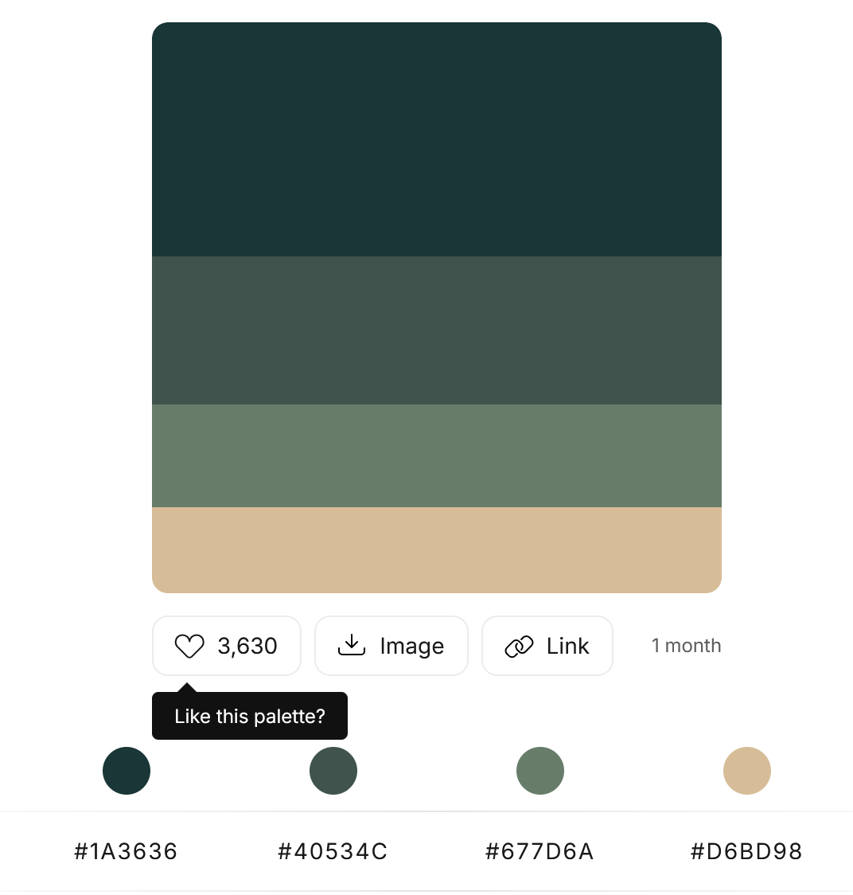

# Ryan Harrison Meyer — Personal Website

My personal portfolio and resume website, built from scratch with plain **HTML, CSS and JavaScript**. It uses no frameworks, no build step and no dependencies.

## Features

- **Animated binary background:** a full-screen wall of 1s and 0s that keeps flipping in a rolling wave behind the content.
- **"Filled with…" glitch text:** on the home page, a word scrambles into binary and resolves into the next word (Passion, Progress, Dedication, Potential, Leadership, Purpose).
- **Dark mode:** a lightbulb button in the bottom-left corner switches between light and dark themes. The choice is saved in `localStorage`. With no saved choice, the site follows the device's `prefers-color-scheme` setting. The theme loads in `<head>`, so pages never flash the wrong theme.
- **Shared header:** the navigation header lives in one file, `header.html`, and each page loads it with `fetch()`.
- **Mobile layout:** on screens 600px wide or less, the header stacks and stops being fixed, sizes switch to `rem` so text stays readable, the photo is centered and tap targets are larger.
- **Scraper-resistant contact info:** the email address and phone number are not in the HTML as plain text. They are stored Base64-encoded and decoded in the browser, which stops simple scrapers that only read the raw HTML.
- **Simple Resume page:** an unstyled, text-only version of the resume that is easy to copy and paste into job applications.

## Pages

| Page | File | Contents |
| --- | --- | --- |
| Info | `index.html` | About me, photo and contact links |
| Experience | `experience.html` | Leadership, competitions and work history |
| Education | `education.html` | Schools, degree, GPA and coursework |
| Simple Resume | `forcopy.html` | Plain-text resume for copying |
| Projects | `projects.html` | Placeholder (hidden from the navigation for now) |

## Color Palette



| Color | Hex | Used for |
| --- | --- | --- |
| Dark teal | `#1A3636` | Header, content sections, dark-mode binary text |
| Slate green | `#40534C` | Page background (light mode), dark-mode borders and banner |
| Sage green | `#677D6A` | "Filled with" banner (light mode) |
| Sand | `#D6BD98` | Links, section text, header border, lightbulb button |

Dark mode adds `#0F1F1F`, a deeper shade of `#1A3636`, for the page background.

## Project Structure

```
├── index.html          # Info / home page
├── experience.html     # Experience page
├── education.html      # Education page
├── projects.html       # Projects page (placeholder)
├── forcopy.html        # Simple Resume page
├── header.html         # Shared header and dark-mode button, loaded into each page
├── styles.css          # All styling, including dark mode and the mobile layout
├── javas.js            # Binary background, glitch text, header loader, contact decoding
├── theme.js            # Dark-mode setup and toggle
├── forcopy.js          # Contact decoding for the Simple Resume page
├── Ryan_Meyer.jpg      # Profile photo
└── color_palette_1.png # Color palette reference
```

## Contact

- [LinkedIn](https://www.linkedin.com/in/ryan-harrison-meyer-687700187/)
- [GitHub](https://github.com/RyanHMeyer)
